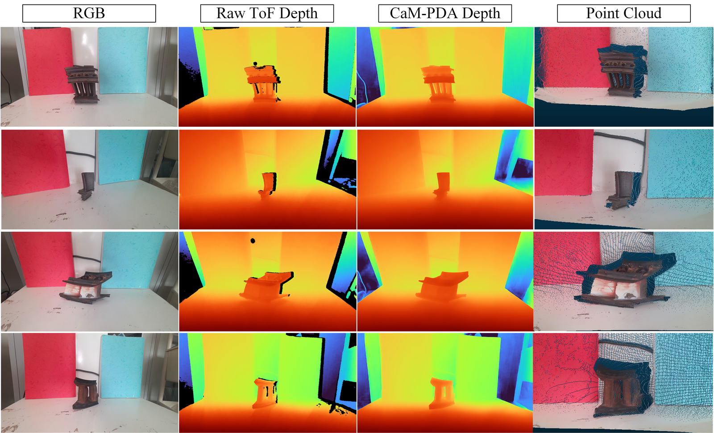

# CaM-PDA

**Confidence-aware RGB-D completion for low-cost, spray-free reconstruction.**

[Paper figures & data](docs/PAPER_DATA.md) · [Download source data](https://github.com/emp1y-fs/CaM-PDA/releases/tag/paper-final-20261027) · [Final benchmarks](docs/BENCHMARKS.md) · [中文](README.zh-CN.md)


Companion repository for **CaM-PDA: Confidence-Aware Prior Depth Completion with a Mixture of Experts for Low-Cost, Spray-Free 3D Reconstruction of Reflective High-Pressure Compressor Blades**, Qing Zhang, Xiaojun Yang, Sibo Wang and Yuqi Fan, *Aerospace*, manuscript **aerospace-4587144**. This snapshot follows the final author proof dated **27 October 2026**. Publication metadata will be updated when a verified article DOI is available.

The specimen is a **first-stage high-pressure compressor blade**. Its exact model is untraceable; all authors confirmed the category. Older working-directory names are not specimen identifiers.

## Explore the final paper

| Resource | What is available |
|---|---|
| [Figures 1–12 and A1](paper/figures/README.md) | Unchanged publication assets, PNG previews, captions, printed figure numbers and source hashes |
| [Tables 1–15 and A1–A8](paper/tables/README.md) | Displayed values as CSV, including units and continued Table A4 |
| [Versioned source-data download](https://github.com/emp1y-fs/CaM-PDA/releases/tag/paper-final-20261027) | Calibrated RGB-D, numerical predictions, observation masks, point clouds, blue-light reference, routing arrays and selected benchmark inputs |
| [Figure-to-data map](docs/PAPER_DATA.md) | Exact file locations, executable checks and coverage of each figure |
| [Final benchmark protocols](paper/manifests/index.json) | **17,354** recorded targets across five sets; identities, seeds and prepared-array fingerprints |
| [Model card](docs/MODEL_CARD.md) | Formal checkpoint identity, input contract and interpretation limits |

<table>
<tr><td><b>Measured blade capture · Figure 7</b><br></td><td><b>Additional components · Figure 12</b><br></td></tr>
</table>

## Run the paper's blade capture

Use Python **3.10–3.12** on Windows or Linux. Install PyTorch for your hardware first; the evaluated release uses PyTorch 2.7.1. [Detailed installation](docs/INSTALL.md).

```console
git clone https://github.com/emp1y-fs/CaM-PDA.git
cd CaM-PDA
python -m pip install torch==2.7.1 --index-url https://download.pytorch.org/whl/cu128
python -m pip install ".[reproduction]"
python -m cam_pda example examples/paper_blade --output outputs/paper_blade
```

For CPU, install PyTorch from `https://download.pytorch.org/whl/cpu` instead. Verified model files download on the first inference; existing files can be supplied with `--checkpoint` and `--mde-checkpoint`. Input depth is float32 **metres**, aligned to RGB. Colorized previews are for viewing and cannot replace numerical depth. Predictions retain their numerical range; visualization normalization does not clip the saved array.

`python run.py` opens the interactive terminal selector for the included blade and engine-component examples or your own calibrated RGB-D. [API and input formats](docs/API.md).

## Download and inspect numerical source data

Run these commands from the source checkout. Inspection and geometry replay do not require model weights or a GPU.

```console
python -m reproduction.paper download --root ./paper_data
python -m reproduction.paper verify --root ./paper_data
python -m reproduction.paper geometry --root ./paper_data
python -m reproduction.paper routing --root ./paper_data
```

The download is pinned by size and SHA256, and each extracted file is verified against [the data manifest](paper/data_manifest.json). The [data guide](docs/PAPER_DATA.md) describes numerical units, calibration, figure crops, fixed point indices and the difference between native PDA, shared-confidence PDA and equal-capacity dense controls.

## Benchmarks and reproducibility

| Final-proof set | Targets | Scope |
|---|---:|---|
| DREDS-CatNovel | **11,520** | Complete frozen evaluation; 11,508 material-eligible targets |
| NYUv2 | **654** | Official test split |
| ICL-NUIM | **80** | Fixed `lr_kt3` targets; trajectory separation within the adaptation living-room scene |
| STD-CatNovel | **4,500** | Complete downloaded CatNovel test archive |
| Procedural role diagnostics | **600** | Author-generated diagnostic set with developmental exposure |

The [final benchmark guide](docs/BENCHMARKS.md) supplies manifests, schema, source links and a verifier/evaluator for these complete sets. Full third-party datasets are obtained from their distributors; this source-data release is not a mirror of every benchmark or every comparison checkpoint.

The historical `python reproduce.py --root ./cam_pda_test` command remains a **legacy 844-target quick check**: DREDS110 + NYUv2 654 + ICL80. It must not be reported as the complete final-paper benchmark. [Reproduction levels and exact coverage](docs/REPRODUCIBILITY.md).

The retained model is campaign **026 / T1 / step 600**, with balanced analytic confidence and independent R/N/E residual specialists. No retraining or checkpoint substitution accompanies this data release. The final paper also reports negative cases and regional regressions; see the table CSVs and Figure 6. Post-registration blade distances describe visible-surface agreement, not independently calibrated industrial metrological accuracy.

## Citation and rights

Use [CITATION.cff](CITATION.cff) for the repository and the manuscript title above for the paper until publication metadata is verified. Please cite the original datasets and upstream PDA / Depth Anything V2 work when using them.

**No new license is granted for author-owned code, trained derivatives, figures or captures; author rights are retained.** Existing upstream software, model and dataset licenses remain in force. Public download availability does not create an additional open-data license. [Rights and third-party notices](licenses/README.md).
