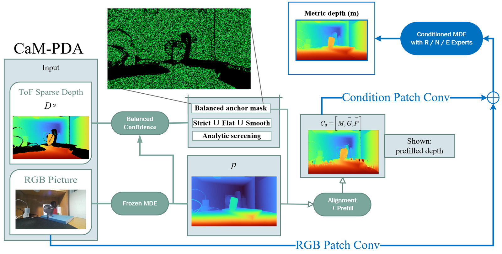
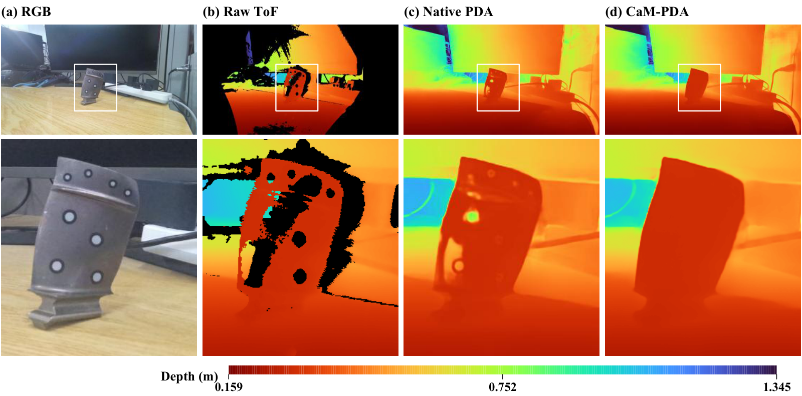

# CaM-PDA

**置信度感知的 RGB-D 深度补全，用于低成本、免喷涂三维重建。**

[English](README.md) · [论文图件与数值数据](docs/PAPER_DATA.md) · [下载数据包](https://github.com/emp1y-fs/CaM-PDA/releases/tag/paper-final-20261027) · [最终稿测试协议](docs/BENCHMARKS.md)



本仓库依据 **2026 年 10 月 27 日最终作者校样**（Aerospace，稿号 aerospace-4587144）整理。论文题目为 *CaM-PDA: Confidence-Aware Prior Depth Completion with a Mixture of Experts for Low-Cost, Spray-Free 3D Reconstruction of Reflective High-Pressure Compressor Blades*，作者为 Qing Zhang、Xiaojun Yang、Sibo Wang、Yuqi Fan。正式发表信息和 DOI 待核实后补充。

实物样件为**第一级高压压气机叶片**；具体型号无法追溯，类别已由全体作者确认。

## 论文资料

| 内容 | 入口 |
|---|---|
| 图 1–12、附录图 A1 | [原版图件、预览、图注与哈希](paper/figures/README.md) |
| 表 1–15、附录表 A1–A8 | [CSV 与单位说明](paper/tables/README.md) |
| 原始深度、模型输出、点云、参考扫描、专家激活 | [版本化下载包](https://github.com/emp1y-fs/CaM-PDA/releases/tag/paper-final-20261027) |
| 各图的数据路径及复算命令 | [数据对应表](docs/PAPER_DATA.md) |
| 五组最终测试、共 17,354 条记录 | [冻结清单、种子与数组指纹](paper/manifests/index.json) |



## 运行论文叶片实例

使用 Windows 或 Linux、Python 3.10–3.12。先安装适配硬件的 PyTorch；下列为 NVIDIA GPU 示例，CPU 用户将 PyTorch 下载地址替换为 `https://download.pytorch.org/whl/cpu`。

```console
git clone https://github.com/emp1y-fs/CaM-PDA.git
cd CaM-PDA
python -m pip install torch==2.7.1 --index-url https://download.pytorch.org/whl/cu128
python -m pip install ".[reproduction]"
python -m cam_pda example examples/paper_blade --output outputs/paper_blade
```

首次运行会下载并校验权重，也可传入已有权重文件。`python run.py` 可交互选择示例或输入自己的文件路径。RGB 与深度须已配准、分辨率相同；浮点 `.npy` 深度单位是**米**。彩色深度预览不等于数值深度。

## 下载与复算

以下命令在仓库目录执行；数据检查、点云距离复算及专家激活统计无需 GPU 或模型权重。

```console
python -m reproduction.paper download --root ./paper_data
python -m reproduction.paper verify --root ./paper_data
python -m reproduction.paper geometry --root ./paper_data
python -m reproduction.paper routing --root ./paper_data
```

下载包与内部文件均有 SHA256 校验。图 7 的实测叶片与图 11 的诊断帧分别存放；图 12 为四组其他发动机部件的定性示例。点云距离是在归档刚性配准和可见表面区域上的一致性结果，不能解释为独立工业计量精度，也不验证隐藏面、厚度或被裁去的完整叶根。

## 测试集范围

最终稿为 DREDS-CatNovel **11,520**、NYUv2 **654**、ICL-NUIM **80**、STD-CatNovel **4,500**，以及程序生成角色诊断 **600** 帧。完整第三方数据需从原发布方获取；仓库提供冻结身份、种子、指纹和完整集校验/评估入口。[详细说明](docs/BENCHMARKS.md)。

旧命令 `python reproduce.py --root ./cam_pda_test` 保留为 **844 帧快速检查**，其中 DREDS 只有 110 帧，不能当成最终论文完整测试。正式权重仍是 **026 / T1 / step 600**；本次发布未训练或替换权重。重新训练的等参数对照和正式部署权重是不同实验，[复现边界](docs/REPRODUCIBILITY.md)分别说明。

作者自有代码、权重衍生、图片与采集数据**暂不新增许可，保留作者现有权利**；第三方代码、权重和数据继续遵守各自原许可。[署名与许可说明](licenses/README.md)。
